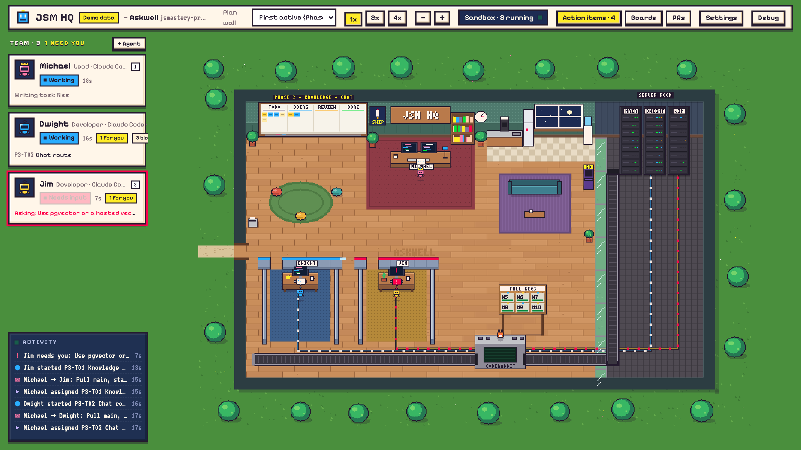
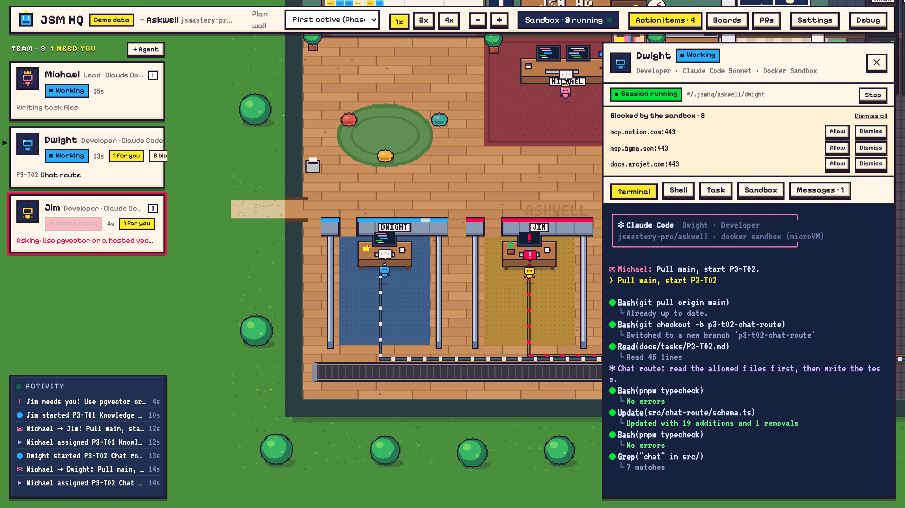

# Matt HQ

**One HQ for all your projects: run a team of AI coding agents on each repo, and watch them work in a pixel-art office.**

Based on [JSM HQ](https://github.com/jsmastery-pro/jsm-hq), with one server for every project and a switcher in the top bar.



One **lead** agent plans the work and hands out tasks. Each **worker** gets its own desk, its own copy of the repo and its own Docker Sandbox, then opens a pull request. You see it all happen: the plan on the wall, agents at their desks, PRs moving through review.

Agents run **Claude Code** or **Codex**. Everything runs on your machine.

## Why use it

- **All your projects in one place.** Add each repo once. The home page shows every project's agents, T3 Code chats and what's waiting on you; switch between them from there or the top bar; a badge shows when another project is waiting on you. Every project keeps its own team, plan and PRs, and their agents keep working while you look at another one.
- **A real team, not one chat.** The lead splits the work into small tasks (one task, one branch, one PR) and assigns them. Agents message each other through HQ.
- **Safe by default.** Each agent works in its own Docker Sandbox, a small VM that can't touch the rest of your computer. Websites are blocked until you allow them.
- **You stay in charge.** Anything an agent needs from you (a decision, an API key, a blocked website) shows up in **Action items**. HQ never merges for you.
- **Your workflow.** Pull requests on GitHub, reviewed by CodeRabbit, Greptile, Copilot or you.
- **Knows your stack.** Pick your tools (Next.js, Clerk, Stripe, Supabase…) and agents get their official agent skills and docs access.

## Quick start

Matt HQ isn't on npm. Install it from source once:

```bash
git clone https://github.com/MatthewChiang92/matt-hq && cd matt-hq
pnpm install && pnpm build
npm link          # puts the matt-hq command on your PATH
```

Then, from anywhere:

```bash
matt-hq
```

HQ opens in your browser and walks you through the rest:

1. **Add a project:** pick a repo from `~/code`, or type the path to any git repo.
2. **Welcome:** name the project and pick a lead and workers (Claude Code or Codex for each).
3. **Setup checklist:** anything missing on your machine is listed with the command to fix it.
4. **Start team** in the top bar, then message the lead, for example: *"Plan two small tasks for Dwight and assign the first one."*

Add more projects any time from the project menu in the top bar (**+ Add project**). Remove one in **Settings → Project**.

**First time?** The [getting-started guide](docs/getting-started.md) takes you from a fresh machine to a working team in about 15 minutes, on macOS, Linux and Windows.

### Options

```
matt-hq --repo <path>   also add this git repo to HQ and open it
        --port <n>      HQ port (default: 7420)
        --no-open       don't open the browser
        --version, --help
```

`HQ_PROJECTS_DIR` changes where **Add project** looks for repos (default: `~/code`).
`HQ_URL` lets HQ be opened from another address, for example a Tailscale serve URL (`tailscale serve --bg --https=8443 http://127.0.0.1:7420`, then `HQ_URL=https://<machine>.<tailnet>.ts.net:8443`). Only use an address that's private to you: anyone with the link can run commands on this machine.

## Requirements

| What | Why |
| --- | --- |
| Node.js 20+ | Runs HQ |
| git and a GitHub repo | Each agent clones it, pushes a branch and opens a PR |
| GitHub CLI (`gh`) | Reads PRs and reviews |
| Docker Sandboxes (`sbx`) | Each agent runs in its own VM |
| tmux (macOS, Linux) | Agents keep running if you close HQ |
| A Claude or ChatGPT account | For the agents themselves |

Sandboxes need **macOS 14+ on Apple silicon, Windows 11, or Ubuntu 24.04+**. On other machines, set agents to **Local** in Settings → Team: they run Claude Code or Codex directly on your machine, with permission prompts on.

You don't need to install these by hand first. HQ checks for each one and shows the exact command. The [getting-started guide](docs/getting-started.md) has every step.

## How it works



1. **You tell the lead what to build.** It creates a board of small tasks, each with the files it may touch, and assigns them.
2. **Workers build in their own sandboxes.** Each one pulls `main`, makes a branch, writes the code and opens a PR titled `[TASK-ID] …`.
3. **HQ follows the PRs on GitHub.** Review comments go back to the author; a passing PR is reported to the lead; a merged PR marks the task done.
4. **Agents ask when they're stuck.** A question, a blocked website or a missing key shows up in **Action items** and on the agent's card.
5. **You review and merge.**

Click any agent to open its drawer: its live terminal, a shell inside its sandbox, its task, its messages, and the websites it tried to reach. Drag the drawer's edge to make it wider, or maximize it. **Terminal** in the top bar opens your own shell in the repo or any agent's folder.

More detail on workspaces, sandboxes, MCP servers, app variables and what HQ saves: **[How it works](docs/how-it-works.md)**.

## Troubleshooting

| Problem | Fix |
| --- | --- |
| A setup check shows "!" but the tool works | You may be on an old HQ. Run `git pull && pnpm install && pnpm build` in the matt-hq folder. |
| Start fails: "network policy has not been initialized" | A new Docker Sandboxes install needs a base policy once: `sbx policy init balanced`. |
| Agents fail to start with a sign-in error | Your Docker sign-in expired. Run `sbx login`, then **Check again** in the setup checklist. |
| Agents can't push or open PRs | Run `sbx secret set github --command "gh auth token"`, and check the repo has a GitHub `origin`. |
| A Codex agent waits on "Do you trust this folder?" | Answer it once in the agent's terminal. HQ never answers trust prompts for you. |
| A CLI sign-in in a sandbox opens the browser, then fails on `localhost:<port>` | Press **Forward port** in the agent's drawer, then reload the page. |
| An agent's state never changes | The sandbox can't reach HQ. `sbx policy ls` should show `localhost:<port>` and `host.docker.internal:<port>` allowed; HQ adds them on start. |
| "Port 7420 is in use" | Another HQ is running. Stop it, or use `--port 7421`. |
| Windows: `listen EACCES` on start | Windows reserved that port. Use `--port 8420`. |
| `posix_spawnp failed` when opening a terminal | Run `pnpm install` again in the matt-hq folder. |

**Remove a project:** delete each agent in Settings → Team (this removes its sandbox and, if you choose, its folder), then **Settings → Project → Remove project**, then delete `~/.matthq/<project>`.

## Docs

- [Getting started](docs/getting-started.md): install everything and run your first team.
- [How it works](docs/how-it-works.md): workspaces, sandboxes, GitHub, MCP, settings and files.
- [Contributing](CONTRIBUTING.md): run HQ from source and release it.

## License

Code: [MIT](LICENSE). Based on JSM HQ by JavaScript Mastery; see [TRADEMARKS.md](TRADEMARKS.md).
